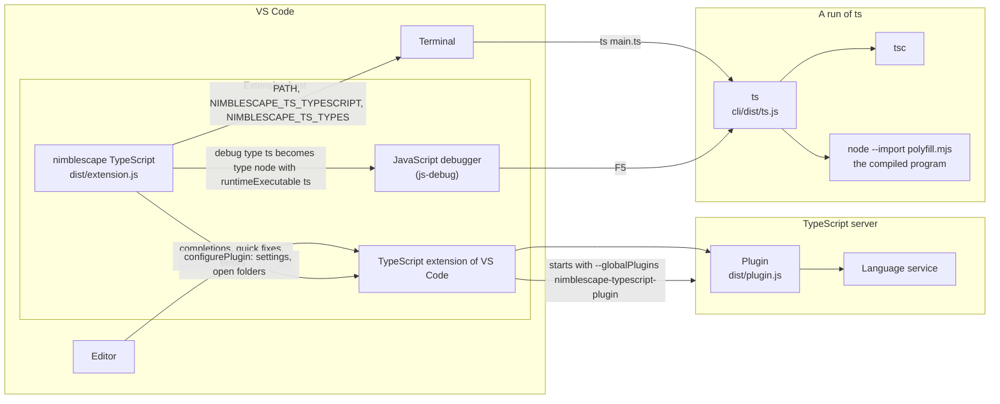

# Architecture

This document describes how nimblescape TypeScript works inside: its three parts, the command `ts`, the debug type `ts`, the editor plugin with its defaults and its filter, how it names things, and how it is tested. The security model is in [security.md](security.md).

## Overview

The repository builds three parts that run in different processes and share no state:

- **The command `ts`** (`cli/dist/ts.js`, with `cli/dist/polyfill.mjs` and `cli/dist/debug-terminal.mjs`) checks, compiles and runs a TypeScript file. It is the npm package `@nimblescape/typescript` of the folder `cli/`, and the package of the extension holds a copy of that folder.
- **The plugin** `nimblescape-typescript-plugin` (`dist/plugin.js`) runs in the TypeScript server. It gives a file without `tsconfig.json` the defaults of `ts`, gives a project of `ts init` the polyfills and ES modules, and filters the auto-imports and the quick fixes "Add import". A project with any other `tsconfig.json` is a standard project, which the plugin leaves to TypeScript.
- **The extension** (`dist/extension.js`) runs in the extension host of VS Code. It puts `ts` into the terminals, resolves the debug type `ts` and sends its settings to the plugin. It shows no pop-up.

The plugin needs no activation of the extension: the TypeScript extension of VS Code reads `contributes.typescriptServerPlugins` from the manifests of all enabled extensions, and starts the TypeScript server with these plugins. The extension activates after the start of VS Code in every window (`onStartupFinished`), and for a debug session of the type `ts`.

`src/defaults.ts` holds the defaults that the command and the plugin share, so the editor and the command line report the same errors. It imports only `node:path`, so every bundle can use it.

## The command ts

`ts` is a wrapper around `tsc` and `node`: every error comes from `tsc` or Node.js, and the only addition to Node.js is the polyfills of `prompt()`, `alert()` and `confirm()`. A run has these steps (`src/cli/ts.ts`):

1. **The command line** (`src/cli/args.ts`, `src/cli/options.ts`). A command word (`check`, `init`, `install` or its short form `i`, `completion`) counts only as the first word, as with npm; every other first word is the file, so `ts ./check` runs a file named `check`. The options stand before the file; every word after the file goes to the program, and `--` ends the options. Without a file, `ts` takes `main.ts` of the current folder. The help and the Tab completion are written from the same lists of `options.ts`.
2. **The project** (`projectOfFile` in `src/cli/compile.ts`): the nearest `tsconfig.json` and the nearest `package.json` above the file, and the module system of the output, from the field `type` of `package.json`; without a `package.json`, `module` when there is no `tsconfig.json` either, else none: every file is an ES module for `tsc` (step 6), but the `module` of a `tsconfig.json` may still make `tsc` write CommonJS, so Node.js reads the syntax of each compiled file.
3. **The packages** (`src/cli/packages.ts`). When `package.json` lists packages that are not installed, `ts` asks whether to run `npm ci` (with `package-lock.json`) or `npm install`. Without a terminal (`src/cli/ask.ts`), it prints the command and ends with 1, so a script never waits for an answer. `ts install` (`installProject`) runs the same command without a question; without a `package.json` that lists packages, it installs TypeScript globally (`installTypeScript` of `src/cli/install.ts`), because `ts` then uses the global TypeScript.
4. **The TypeScript** (`src/cli/typescript.ts`): the TypeScript of the project, when `package.json` lists `typescript`; else the folder in `NIMBLESCAPE_TS_TYPESCRIPT`, which the extension sets to the TypeScript of VS Code; else the global TypeScript. It must be TypeScript 6 or newer. When there is none, `src/cli/install.ts` offers to install one globally: a list in the terminal (`askChoice` of `src/cli/ask.ts`, with the terminal in raw mode) shows the versions of npm, newest first, with the recommended one selected; the arrow keys select, Enter installs, Esc, Ctrl+C or Ctrl+D cancels. A global TypeScript below TypeScript 6 gets the question whether to upgrade it, then the same list (`offerUpgrade`).
5. **The folder of the run** (`src/cli/run.ts`): `node_modules/.cache/ts/<process ID>-<random>/` of the project, so that Node.js finds the packages of the project from the compiled files, or `nimblescape-ts-<user ID>/<process ID>-<random>/` in the temporary folder of the system without a `package.json`. The folder is a real path, without symbolic links, because `tsc` writes the sources of a source map relative to the folder of the map, and Node.js and the debugger resolve them from the real path of the compiled file. A folder of an earlier `ts` whose process does not exist anymore goes at the next start.
6. **The check and the output** (`compile` in `src/cli/compile.ts`). `ts` writes a temporary `tsconfig.json` into the folder of the run and runs `tsc --project` with it. With a `tsconfig.json` of the project, the temporary file extends it and lists only the file, the declaration files of the project (for example `globals.d.ts`; TypeScript 7 prints them with `--showConfig`) and, in a project of `ts` (see "Projects with a tsconfig.json" below), the declaration file of the polyfills (`types/nimblescape-globals/index.d.ts`), unless the project has `lib` `dom` or no `lib` (the full library of the target, with `dom`). `ts check` without a file checks the project of the `tsconfig.json` of the folder: a project with `references` with `tsc --build`; any other with `--noEmit`, and, when the polyfills are added, with a temporary file in the folder of the run that extends the `tsconfig.json` and lists every file of the project. `tsc` looks for the type packages from the folder of the `tsconfig.json` that it reads. When the folder of the run lies outside the project (no `package.json`, so the folder is in the temporary folder of the system), the temporary file names the folders `node_modules/@types` of the project as `typeRoots`, unless the project sets `typeRoots` itself. Only then: with `typeRoots`, `tsc` no longer looks into `node_modules` for a package that `"types"` names, such as `vite/client` of a Vite project. Without a `tsconfig.json`, it holds the defaults of `ts`. Both add the output settings: `outDir` in the folder of the run, `rootDir` at the root of the file system, `sourceMap`, `noEmitOnError` and `rewriteRelativeImportExtensions`. TypeScript 6 runs in the process of `ts` (`executeCommandLine` of `typescript.js`, because the TypeScript of VS Code has no `tsc.js`), TypeScript 7 as its own program.
7. **The run.** `node --enable-source-maps --import polyfill.mjs <compiled file> <arguments>` in the folder where `ts` started. `ts` waits for the program, deletes the folder of the run, and ends with the exit code of the program. Ctrl+C reaches both processes, and `ts` only waits for the program to end.

### Projects with a tsconfig.json

A `tsconfig.json` belongs to `ts` only when its `compilerOptions.plugins` names the editor plugin (`isTsProject` in `src/defaults.ts`), as `ts init` writes it. Only such a project gets the rules of `ts`: the declaration file of the polyfills and, without a `package.json`, the `package.json` `{"type": "module"}` at the root of the file system. Any other `tsconfig.json` is a standard project, for example a Vite project: `ts` checks it as `tsc` does, and the plugin returns its language service unchanged. So a standard project is the normal case, and the editor shows there what `tsc` and the build of the project show. The marker is a line of the project, visible in the file: a student who deletes it gets a standard project. The plugin reads the marker from the options of the project, and `ts` from the parsed `tsconfig.json` (TypeScript 7: `--showConfig`), so both follow `extends`. A folder without `tsconfig.json` always belongs to `ts`.

### ts init

`src/cli/init.ts` takes the `tsconfig.json` of `tsc --init` from the TypeScript that `ts` uses and changes it (lines for Node.js with `rewriteRelativeImportExtensions`, so that an import names the `.ts` file also in the editor and in plain `tsc`; the entry of the plugin in `compilerOptions.plugins`, which marks the project of `ts`; no `noUncheckedIndexedAccess`, `declaration`, `declarationMap` and `jsx`). `ts` has no option for code of the browser: such code belongs in a Vite project with the `tsconfig.json` of its template. A project with a `tsconfig.json` gets its settings, as with `tsc`, so `ts init` also prepares what these settings need. Like Deno, it needs no other file: `ts` and the plugin add the types of the polyfills and make every file an ES module without a `package.json`, so `module` `nodenext` does not read a file as CommonJS, whose imports would be error TS1295 under `verbatimModuleSyntax`. TypeScript 7 cannot use the `package.json` that `ts` assumes, so with TypeScript 7, `ts init` writes a `package.json` with `"type": "module"` when the folder and the folders above have none. When the folder cannot find `@types/node`, it asks to run `npm install --save-dev @types/node`, or names the command without a terminal. It replaces no existing file.

### The defaults without tsconfig.json

| Setting | Value |
| --- | --- |
| `module` | `nodenext` |
| `lib` | `["esnext"]` |
| `types` | `["node", "nimblescape-globals"]`, from the type folder of `ts` (`typeRoots`) |
| `skipLibCheck` | `true` |
| `rewriteRelativeImportExtensions` | `true` |

Everything else is the built-in default of `tsc`. Without a `package.json`, `ts` gives `tsc` a file system with a `package.json` `{"type": "module"}` at the root of the file system (`virtualSystem`), so every file is an ES module, as Node.js treats it in the folder of the run. It does so also for a project with a `tsconfig.json`, in the check of one file and in `ts check` without a file. TypeScript 7 runs as its own program and cannot use that file system, so without a `tsconfig.json`, `ts` sets `module` `preserve` and `moduleResolution` `bundler` there; a project with a `tsconfig.json` needs a real `package.json` with TypeScript 7.

The type folder `cli/types/` holds `nimblescape-globals/index.d.ts`, the types of the polyfills. `@types/node` is the only dependency of the npm package, so the types of Node.js are in `cli/node_modules/@types/node`. `NIMBLESCAPE_TS_TYPES` names another type folder.

### The environment variables

| Variable | Set by | Read by | Effect |
| --- | --- | --- | --- |
| `NIMBLESCAPE_TS_TYPESCRIPT` | The extension, in the terminals and the debug sessions | `ts` | The folder of the TypeScript of VS Code, which `ts` takes when the project lists no TypeScript. |
| `NIMBLESCAPE_TS_TYPES` | The extension | `ts` | The folder `cli/` of the extension, whose `types/` and `@types/node` the plugin uses too. |
| `NIMBLESCAPE_TS_DEBUG` | The debug type `ts` | `ts` | `1` or `stop-on-entry`. Loads `debug-terminal.mjs` before the program, which clears the command line that VS Code typed into the terminal; `stop-on-entry` also loads `stop-on-entry.mjs`, which pauses the program at its first statement. |

`ts` removes `NIMBLESCAPE_TS_DEBUG` from the environment of the program, so a `ts` that the program starts runs as in a terminal.

## The terminals of VS Code

The extension sets the environment of the terminals with `environmentVariableCollection` (`src/environment.ts`):

- `PATH` ends with `bin/` of the storage folder of the extension (`globalStorageUri`), which holds `ts`, a shell script that starts `cli/dist/ts.js` of the extension with the Node.js of the `PATH`. The folder stands at the end, so a global `ts` of npm comes first and decides the version.
- `NIMBLESCAPE_TS_TYPESCRIPT` and `NIMBLESCAPE_TS_TYPES`, as above. The TypeScript of VS Code is its own, or the folder of the user setting `js/ts.tsdk.path` (`typescript.tsdk` before VS Code 1.143).
- `XDG_DATA_DIRS` gets a folder with `bash-completion/completions/ts`, which bash-completion loads, and `FPATH` a folder with `_ts`, which the `compinit` of zsh loads (`src/cli/completion.ts`).

The terminals that are open when the extension starts get the change after a restart; VS Code shows that on their tabs. VS Code keeps the collection for the next start of the window.

## The debug type ts

The extension has no debug adapter of its own (`src/debugType.ts`). `TsConfigurationProvider` turns a configuration of type `ts` into one of type `node`, and VS Code then resolves it with the JavaScript debugger of VS Code (js-debug), whose type for Node.js is `pwa-node`:

| Attribute | Value |
| --- | --- |
| `runtimeExecutable` | The global `ts`: the file `ts` on the `PATH` whose real path ends with `@nimblescape/typescript/dist/ts.js`; else the script `ts` of the extension. |
| `args` | The program, then the `args` of the configuration; the program is `program` of the configuration, `${file}` by default. js-debug gets no `program`: it would replace a `.ts` file for which `outFiles` has a compiled file by that file, for example while another run of the same file pauses, and `ts` runs `.ts` files only. |
| `cwd` | The folder of the program. |
| `console` | `integratedTerminal`, where `prompt()` reads the keyboard. |
| `outFiles` | The default of js-debug (`${workspaceFolder}/**/*.(m|c|)js` without `node_modules`) and the real folder of the runs of the project; none without an open folder. js-debug reads the source maps of the compiled files when it attaches to the program, after `tsc` wrote them, and sets the breakpoints of the `.ts` files before the program runs. |
| `pauseForSourceMap` | `false` with an open folder: js-debug reads `outFiles` only then, and its pause for the source maps comes for ES modules only, never for CommonJS. `true` without an open folder, where js-debug reads no `outFiles`; a program there is an ES module unless a `package.json` says otherwise. |
| `resolveSourceMapLocations` | The workspace folder, `**/node_modules/.cache/ts/**`, the folders of `ts` in the temporary folder of the system, and the real folder of the runs of the project. |
| `skipFiles` | Node.js itself, the packages and the files of `ts` (also by their real path, when the folder of `ts` lies behind a symbolic link), but not the compiled files in `node_modules/.cache/ts/`. |
| `killBehavior` | `polite`: Stop and Restart end the program with SIGTERM, and `ts` then deletes the folder of the run. With SIGKILL, the default of js-debug, the folder would stay until the next run of `ts`. |
| `env` | `NIMBLESCAPE_TS_TYPESCRIPT`, `NIMBLESCAPE_TS_TYPES` and `NIMBLESCAPE_TS_DEBUG` (`stop-on-entry` with `stopOnEntry`). |

Every attribute that the configuration sets itself wins. js-debug attaches to every Node.js process of the session: to `ts`, as the parent session, and to the program, as its child session.

The configuration carries the marker `__nimblescapeTs`. `RunFolderProvider`, a provider for the type `pwa-node` that runs after VS Code replaced the variables of the configuration, adds the real folder of the runs of the project to `outFiles` and `resolveSourceMapLocations` (`realCacheFolder` of `src/cli/run.ts`; a real path, because a symbolic link named `node_modules` may point to a folder of another name).

`stopOnEntry` does not go to js-debug. Its entry breakpoint lies at line 1, column 1 of the compiled file, and V8 moves such a breakpoint to the first place where it can stop, which is inside the first function of the file when the file declares one before its first statement. `ts` pauses itself instead, as `node --inspect-brk` does (`src/runtime/stopOnEntry.ts`): the program starts through `callAndPauseOnStart` of the inspector of Node.js, which pauses at the first statement that runs.

- An ES module runs its imports first. A hook of the module loader appends the import of `pause.mjs` to the main module, so the pause comes after the imports, right before the first statement of the file. The hook needs `module.registerHooks()` of Node.js 22.15 or later.
- A CommonJS program: the main module runs in an inner function with the parameters of the function of Node.js (`exports`, `require`, `module`, `__filename`, `__dirname`), on the same lines and columns, so its variables are in the same scope as without the pause. The first statement is `Object.defineProperty(exports, "__esModule", …)` of `tsc`, which has no place in the `.ts` file, so js-debug steps on to the first statement of the `.ts` file and reports the reason `step` instead of `pause`, as after `node --inspect-brk`. The function of Node.js stays below the inner function in the call stack; js-debug shows it as skipped, because its position on line 1 has no position in the `.ts` file. The hook of the module loader changes the source, because Node.js 22 compiles a CommonJS module whose source a hook gave without `Module.prototype._compile`; Node.js 24 and later call both. Without `module.registerHooks()`, an override of `Module.prototype._compile` changes it.

A restart of the session starts `ts` with the same environment, so the program pauses at its first statement again.

Without `launch.json`, F5 gives an empty configuration, which becomes "Run TypeScript file" for the file of the active editor; the list of "Run and Debug" offers the same configuration (`DebugConfigurationProviderTriggerKind.Dynamic`).

## The plugin

The plugin (`src/plugin.ts`) wraps the language service of each project of the TypeScript server with a proxy that forwards every method, and replaces two: `getCompletionsAtPosition` and `getCodeFixesAtPosition`. For an inferred project, the project of open files without `tsconfig.json`, it also applies the defaults of `ts`; a configured project of `ts` gets the types of `prompt()`, `alert()` and `confirm()`. For a configured project whose `tsconfig.json` does not name the plugin, it returns the language service unchanged: no defaults, no filter.

### The defaults in the editor

Without `tsconfig.json`, the TypeScript server puts the open files into an inferred project, whose options VS Code sends: `moduleResolution` `bundler`, the types of the browser, and no types of Node.js. The plugin (`src/projectDefaults.ts`) replaces them with the defaults of `ts`, with the type folder `cli/` of the extension, each time VS Code sends them again, but only while one of the open files of the project is a TypeScript file: before each update of the project, it compares the open files with the last decision and sets the defaults of `ts` or the last options of VS Code again, so the server builds the program anew. A project with only JavaScript files, for example the script of a web page, keeps the options of VS Code with the types of the browser. VS Code puts all open files without `tsconfig.json` of one workspace folder into one project, so a TypeScript file and a JavaScript file that are open together share the defaults of `ts`. Without a `package.json`, the project answers a `package.json` `{"type": "module"}` at the root of the file system, as `ts` does. It does so also with the options of VS Code, whose `moduleResolution` `bundler` reads no `type` for the files of the project, because the server keeps what it read about `package.json` files when the options change. A configured project, one with `tsconfig.json`, keeps its settings. It answers the same `package.json` at the root of the file system, and it gets the declaration file of the polyfills (`cli/types/nimblescape-globals/index.d.ts` of the extension) as one more file, as `ts` adds it, unless its `lib` has `dom` (or it has no `lib`, so `tsc` takes the full library of the target with `dom`): the browser declares the three functions itself. The plugin checks `lib` each time the server asks for the files of the project, so a change of `tsconfig.json` applies with the next update. Like Deno with its built-in library `deno.window`, the project needs no file of its own for the three functions; plain `tsc` does not know them.

The inferred project knows only the open files and the files that they import. The plugin adds the TypeScript files of the assignment roots of the open files, up to 300 for one root, without packages and hidden folders, so an auto-import also finds a file of the assignment that is not open. The TypeScript server asks for the files of a project only when one of them changed, so a new file appears after the next change.

### The assignment root

A course repository holds many assignments, and an auto-import from another assignment is never what a student wants. The assignment root of a file (`src/assignmentRoot.ts`) is the first folder of two searches, from the folder of the file upwards, below the repository root, which never counts:

1. A folder that the setting `assignmentFolders` names (default `workspace`), or that holds `package.json` or `tsconfig.json`. The nearest one wins.
2. Only when the first search finds nothing: a folder with a file that the setting `entryFiles` names (default `main.ts`).

The repository root is the folder that VS Code has open around the file, which the extension sends; else the nearest folder with `.git`. The settings come from the entry of the plugin in `compilerOptions.plugins` of `tsconfig.json`, else from the settings `nimblescape.typescript.*` of VS Code, which the extension sends with `configurePlugin` of the API of the TypeScript extension at its start and after each change (`src/pluginSettings.ts`), else the defaults apply.

### The filter

TypeScript offers an auto-import for every export of every module that the program can import. The filter (`src/autoImportFilter.ts`) removes an auto-import entry, an entry whose data names an export (`data.exportName`), with three rules:

1. **The name is global.** The name of the entry is the name of a symbol in the scope of the file: a global of the libraries and packages of types, or a declaration at the top level of the file. The type checker gives these names (`getSymbolsInScope` with the meaning `Value`). An interface or a type alias can only be a type, so for these entries the filter uses the names with the meaning `Type` or `Namespace`. The rule hides `parseInt` of `es-toolkit/compat`, because the global `parseInt` exists.
2. **The module exports a global.** The module of the entry exports one value with `export =`, and that value is a variable whose name is a global. `node:process` declares `export = process`, and `process` is global; `node:console` declares a variable `console` of its own and exports it with `export =`, and `console` is global. So the rule hides `exit` and `argv` of `node:process`, and `log` and `warn` of `node:console`. `node:events` exports the class `EventEmitter` with `export =`, which is no global, so `on` and `once` of `node:events` stay.
3. **The file lies in another assignment.** The module of the entry is a file of the student (no `node_modules` in its path) outside the assignment root of the file. A package and a module of Node.js always stay, and without an assignment root the rule hides nothing.

The quick fixes "Add import" of an error follow rule 3 (`filterImportFixes`): the filter reads the module of each fix from the text that the fix inserts. Rules 1 and 2 apply to the completions only.

An inferred project with only JavaScript files open keeps the completions and the quick fixes of VS Code, as it keeps its options: the filter applies only while the defaults of `ts` apply (`applyDefaults` returns this state). Rule 1 would hide there the import of a package whose name is a global of the browser or of JavaScript, for example the icons `Map`, `Image` and `File` of lucide-react in a Vite project with JavaScript.

The filter keeps every other entry, in its order, and returns a new list, because TypeScript keeps the result of an incomplete list for the next request. Rule 2 reads each module once per request. A module comes from the program of the file, or, for an entry of a package of `package.json` that the program does not import yet (`data.isPackageJsonImport`), from the program of the package.json imports of the TypeScript server (`getPackageJsonAutoImportProvider` of the project, an internal method). The rules read the program. They name no module and no package, so a project with other packages, other libraries in `tsconfig.json` or its own global declarations gets the same rules.

### How the TypeScript server finds the plugin

The TypeScript extension of VS Code starts the TypeScript server with the name of each plugin in `--globalPlugins` and the folder of each extension in `--pluginProbeLocations`. The TypeScript server loads a plugin as a package: it calls `require()` for `<folder of the extension>/node_modules/<name of the plugin>`. For a project whose `tsconfig.json` names the plugin, the server loads it through that entry, from the same folders, and skips the global plugin of the same name (`enableGlobalPlugins` of TypeScript 6.0.3), so the plugin runs once per project. The name of the plugin must therefore be the name of a package in the folder `node_modules` of the extension, and the module must export the factory function of the plugin (`export = init`, which esbuild bundles as `module.exports = init`).

The repository has this package in `plugin/`: `plugin/package.json` with the name `nimblescape-typescript-plugin` and the main file `../../dist/plugin.js`. The manifest lists it as the only runtime dependency, `"nimblescape-typescript-plugin": "file:plugin"`:

- In the repository, `npm ci` links `node_modules/nimblescape-typescript-plugin` to `plugin/`. Node.js resolves the main file from the path of the link, `node_modules/nimblescape-typescript-plugin/../../dist/plugin.js`, which is `dist/plugin.js` of the repository. So the launch configuration "Run the extension" and the tests load the plugin from the folder of the repository.
- vsce packages the runtime dependencies that `npm list --production` names, with their files: `node_modules/nimblescape-typescript-plugin/package.json` in the VSIX is a copy, and the same path leads to `dist/plugin.js` of the installed extension.

The plugin finds the type folder `cli/` next to `dist/`, the folder of its bundle. It gets the TypeScript module of the running TypeScript server as its argument, and imports TypeScript for its types only. So one bundle works with the TypeScript of VS Code and with the TypeScript of the workspace, which the manifest allows with `enableForWorkspaceTypeScriptVersions`.

## Where the data lives

| Data | Where | How long |
| --- | --- | --- |
| The script `ts` and the Tab completion scripts | `bin/` and the completion folders of the storage folder of the extension (`globalStorageUri`) | Until the extension is removed; the extension writes them again at each start |
| The environment of the terminals | `environmentVariableCollection` of VS Code | Until the extension is removed |
| The folder of a run: the temporary `tsconfig.json` and the compiled files | `node_modules/.cache/ts/` of the project, or the temporary folder of the system | Until the run ends; the next `ts` deletes a folder whose process does not exist anymore |
| The settings of the assignment roots | The memory of the TypeScript server | Until the TypeScript server ends |

The extension and the plugin change no setting and no file of the workspace.

## Naming

| What | Name |
| --- | --- |
| Extension ID | `nimblescape.nimblescape-typescript` (see [Naming](../CONTRIBUTING.md#naming)) |
| npm package | `@nimblescape/typescript`, with the command `ts` |
| Plugin of the TypeScript server | `nimblescape-typescript-plugin`, the name of the package in `plugin/` |
| Debug type | `ts`, with the label "TypeScript (ts)" |
| Settings | `nimblescape.typescript.assignmentFolders`, `nimblescape.typescript.entryFiles` |
| Environment variables | `NIMBLESCAPE_TS_TYPESCRIPT`, `NIMBLESCAPE_TS_TYPES`, `NIMBLESCAPE_TS_DEBUG` |
| Type package of the polyfills | `nimblescape-globals`, in `cli/types/` |
| API for the tests | `installStates()`, the return value of `activate` |

The extension has no commands.

## Code layout and build

| Folder | Content |
| --- | --- |
| `src/` | The extension (`extension.ts`, `environment.ts`, `debugType.ts`, `pluginSettings.ts`), the plugin (`plugin.ts`, `projectDefaults.ts`, `assignmentRoot.ts`, `autoImportFilter.ts`) and the shared defaults (`defaults.ts`). |
| `src/cli/` | The command `ts`. |
| `src/runtime/` | The modules that Node.js loads before the program: the polyfills and the module of the debug terminal. |
| `cli/` | The npm package `@nimblescape/typescript`: its manifest, its README, its type folder `types/`, and the bundles in `cli/dist/`. |
| `plugin/` | The package `nimblescape-typescript-plugin`, whose main file is `dist/plugin.js`. |
| `test/unit/` | Unit tests with vitest, without VS Code. |
| `test/cli/` | Tests of the built command `ts`. |
| `test/tsserver/` | Tests with the TypeScript server of the examples. |
| `test/vscode/` | Tests in a real VS Code with mocha. |
| `examples/` | A small course project, which the tests and the launch configuration "Run the extension" use. |
| `scripts/` | The local install and uninstall, the build of the VS Code tests, the setup of the Marketplace and of npmjs.com, and the shared release scripts. |
| `resources/` | The icon of the Marketplace. |

`esbuild.mjs` builds seven files: `dist/extension.js` (CommonJS, Node.js 24, without the module `vscode`), `dist/plugin.js` (CommonJS, Node.js 22, without any import), `cli/dist/ts.js` (CommonJS, Node.js 22, with the version of the manifest and the TypeScript of the development tools as the offline default of the install), and the modules that `ts` loads before the program, `cli/dist/polyfill.mjs`, `cli/dist/debug-terminal.mjs`, `cli/dist/stop-on-entry.mjs` and `cli/dist/pause.mjs` (ES modules, Node.js 22). Every file is readable, not minified. TypeScript checks the types (`npm run typecheck`); esbuild does not.

The development tools use TypeScript 6.0.3, the TypeScript of VS Code, because the plugin uses the language service of TypeScript 6 and TypeScript 7 has none for plugins.

## Testing

| Command | What it tests |
| --- | --- |
| `npm test` | The unit tests of `test/unit/`: the rules of the filter with a language service of TypeScript 6.0.3 and a project with its own global declarations and modules in a temporary folder, the assignment roots, the parts of `ts` that need no child process (the command line, the help, the Tab completion, `ts init`, the install question, the temporary `tsconfig.json`), the configuration of the debug type, the manifests of the extension and of the npm package, the files of both packages (`vsce ls`, `npm pack --dry-run`), the documents and the license headers. Also the test of the release check (`scripts/release-checks.test.mjs`). |
| `npm run test:cli` | Builds the bundles and runs the built `ts` in small folders in the temporary folder of the system: runs with arguments, `prompt()` and `confirm()`, type errors, the lines of the `.ts` file in an error, the folder of the run (also behind a symbolic link), packages of a project, a `tsconfig.json` of a project, `ts check`, `ts init`, `ts install` with a fake `npm`, `ts completion`, `--version` and `--help`. CI runs them on Ubuntu and macOS, with Node.js 22 and 26. |
| `npm run test:tsserver` | Starts the TypeScript server of `examples/` (TypeScript 6.0.3) as the TypeScript extension of VS Code starts it, without and with the plugin. It checks that the server loads the plugin, also through the entry of a `tsconfig.json`, the hidden and the kept auto-imports, the defaults of `ts` in a folder without `tsconfig.json`, an auto-import of a file that is not open, the polyfills in a project of `ts init`, a standard project (the errors of `tsc`, and the import of `Location` of a package in a project with `lib` `dom`), JavaScript files with the completions of VS Code, and rule 3 for the completions and the quick fixes. The server without the plugin runs from a copy of TypeScript outside the repository, because the server also looks for the plugin of a `tsconfig.json` from the folder above its own package. Needs `npm ci --ignore-scripts --prefix examples` and `npm ci --ignore-scripts --prefix cli`. |
| `npm run test:vscode` | Starts a real VS Code (`@vscode/test-cli`) three times: with the folder `examples/` and the TypeScript of VS Code, with the folder `examples/` and its own TypeScript (`typescript.tsdk`), and with a course without `tsconfig.json` and `package.json` in the temporary folder of the system. It checks the completions that the editor shows, the log of the TypeScript server, the errors of a file without `tsconfig.json`, and debug sessions of the type `ts`: runs, type errors, `stopOnEntry` (also in a file that declares a function before its first statement, with the scopes of the variables, and after a restart), a second run while the first pauses, breakpoints in two files (without `package.json`, with one, behind a `node_modules` that is a symbolic link, and in CommonJS), `prompt()` in the integrated terminal and F5 without `launch.json`. `VSCODE_TEST_VERSION` selects the VS Code version. |

CI runs all of them for every push to `main` and every pull request; the workflow "VS Code versions" runs the tests in VS Code once per week on VS Code Insiders and on the lowest supported version (see [CONTRIBUTING.md](../CONTRIBUTING.md)).

© 2026 Hannes Stauss (scalarion@nimblescape.com) · [MIT License](../LICENSE).
