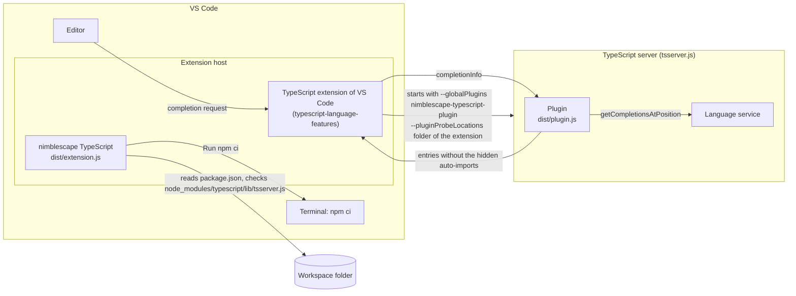

# Architecture

This document describes how nimblescape TypeScript works inside: its two parts, the rules of the filter, how VS Code finds the plugin, the install hint, how it names things, and how it is tested. The security model is in [security.md](security.md).

## Overview

The extension has two parts that run in two processes and share no state:

- **The plugin** `nimblescape-typescript-plugin` (`dist/plugin.js`) runs in the TypeScript server and filters the completions.
- **The extension** (`dist/extension.js`) runs in the extension host of VS Code and shows the install hint.

The plugin needs no activation of the extension: the TypeScript extension of VS Code reads `contributes.typescriptServerPlugins` from the manifests of all enabled extensions, and starts the TypeScript server with these plugins. The TypeScript server then calls the plugin for each project.

## The filter

TypeScript offers an auto-import for every export of every module that the program can import. The filter (`src/autoImportFilter.ts`) removes an auto-import entry, an entry whose data names an export (`data.exportName`), with two rules:

1. **The name is global.** The name of the entry is the name of a symbol in the scope of the file: a global of the libraries and packages of types, or a declaration at the top level of the file. The type checker gives these names (`getSymbolsInScope` with the meaning `Value`). An interface or a type alias can only be a type, so for these entries the filter uses the names with the meaning `Type` or `Namespace`. The rule hides `parseInt` of `es-toolkit/compat`, because the global `parseInt` exists.
2. **The module exports a global.** The module of the entry exports one value with `export =`, and that value is a variable whose name is a global. `node:process` declares `export = process`, and `process` is global; `node:console` declares a variable `console` of its own and exports it with `export =`, and `console` is global. So the rule hides `exit` and `argv` of `node:process`, and `log` and `warn` of `node:console`. `node:events` exports the class `EventEmitter` with `export =`, which is no global, so `on` and `once` of `node:events` stay.

The filter keeps every other entry, in its order, and returns a new list. Rule 2 reads each module once per request. A module comes from the program of the file, or, for an entry of a package of `package.json` that the program does not import yet (`data.isPackageJsonImport`), from the program of the package.json imports of the TypeScript server (`getPackageJsonAutoImportProvider` of the project, an internal method).

The rules read the program. They name no module and no package, so a project with other packages, other libraries in `tsconfig.json` or its own global declarations gets the same rules.

## How the TypeScript server finds the plugin

The TypeScript extension of VS Code starts the TypeScript server with the name of each plugin in `--globalPlugins` and the folder of each extension in `--pluginProbeLocations`. The TypeScript server loads a plugin as a package: it calls `require()` for `<folder of the extension>/node_modules/<name of the plugin>`. The name of the plugin must therefore be the name of a package in the folder `node_modules` of the extension, and the module must export the factory function of the plugin (`export = init`, which esbuild bundles as `module.exports = init`).

The repository has this package in `plugin/`: `plugin/package.json` with the name `nimblescape-typescript-plugin` and the main file `../../dist/plugin.js`. The manifest lists it as the only runtime dependency, `"nimblescape-typescript-plugin": "file:plugin"`:

- In the repository, `npm ci` links `node_modules/nimblescape-typescript-plugin` to `plugin/`. Node.js resolves the main file from the path of the link, `node_modules/nimblescape-typescript-plugin/../../dist/plugin.js`, which is `dist/plugin.js` of the repository. So the launch configuration "Run the extension" and the tests load the plugin from the folder of the repository.
- vsce packages the runtime dependencies that `npm list --production` names, with their files: `node_modules/nimblescape-typescript-plugin/package.json` in the VSIX is a copy, and the same path leads to `dist/plugin.js` of the installed extension.

The plugin gets the TypeScript module of the running TypeScript server as its argument, and imports TypeScript for its types only. So one bundle works with the TypeScript of VS Code and with the TypeScript of the workspace, which the manifest allows with `enableForWorkspaceTypeScriptVersions`.

The plugin wraps the language service of each project with a proxy that forwards every method, and replaces `getCompletionsAtPosition` (`src/plugin.ts`). It returns a new result object, because TypeScript keeps the result of an incomplete list for the next request.

## The install hint

Without `node_modules/typescript/lib/tsserver.js`, the setting `typescript.tsdk` of a course (`node_modules/typescript/lib`) points to nothing, VS Code falls back to its own TypeScript, and the editor finds no types of the packages. The install hint (`src/installHint.ts`, with the checks of `src/installCheck.ts`) offers the repair.

| State of a folder | When | What the extension does |
| --- | --- | --- |
| `none` | `package.json` lists no `typescript`, or the folder has the lock file of Yarn, pnpm or Bun and no `package-lock.json` | Nothing |
| `installed` | `tsserver.js` exists, or `node_modules/typescript` holds TypeScript 7 or later, which has no `tsserver.js` | Nothing |
| `missing` | `package.json` lists `typescript` in `dependencies`, `devDependencies` or `optionalDependencies`, and `tsserver.js` is missing | Shows the hint with **Run npm ci** (or **Run npm install** without `package-lock.json`), and waits for `tsserver.js` with a file watcher and a check every 2 seconds |
| `reload` | `tsserver.js` appeared while the state was `missing` | Shows the hint with **Reload window**, and checks nothing more until the window reloads |

The extension checks every folder of the workspace at its activation, when the folders of the workspace change, when the workspace becomes trusted, and when the `package.json` file of a folder changes. It checks only folders on the disk (scheme `file`) of a trusted workspace.

The file watcher of the workspace excludes `node_modules` (`files.watcherExclude`), and a container may have no free inotify watches. So the extension waits for `tsserver.js` with a watcher whose base is the folder `node_modules/typescript/lib`, and also with a timer.

## Where the data lives

| Data | Where | How long |
| --- | --- | --- |
| The state of the hint of each folder | The memory of the extension host (`InstallHints`) | Until the window closes or reloads |
| The terminal of the install | VS Code | Until you close it |

The plugin keeps no state between two requests. Neither part writes a file or a setting.

## Naming

| What | Name |
| --- | --- |
| Extension ID | `nimblescape.nimblescape-typescript` (see [Naming](../CONTRIBUTING.md#naming)) |
| Plugin of the TypeScript server | `nimblescape-typescript-plugin`, the name of the package in `plugin/` |
| API for the tests | `installStates()`, the return value of `activate` |

The extension has no commands and no settings.

## Code layout and build

| Folder | Content |
| --- | --- |
| `src/` | The extension (`extension.ts`, `installHint.ts`, `installCheck.ts`) and the plugin (`plugin.ts`, `autoImportFilter.ts`). |
| `plugin/` | The package `nimblescape-typescript-plugin`, whose main file is `dist/plugin.js`. |
| `test/unit/` | Unit tests with vitest, without VS Code. |
| `test/tsserver/` | Tests with the TypeScript server of the examples. |
| `test/vscode/` | Tests in a real VS Code with mocha. |
| `examples/` | A small course project, which the tests and the launch configuration "Run the extension" use. |
| `scripts/` | The local install and uninstall, the build of the VS Code tests, and the shared release scripts. |
| `resources/` | The icon of the Marketplace. |

`esbuild.mjs` builds two bundles in CommonJS format: `dist/extension.js` (Node.js 24, without the module `vscode`) and `dist/plugin.js` (Node.js 22, without any import). Both bundles are readable, not minified. TypeScript checks the types (`npm run typecheck`); esbuild does not.

The development tools use TypeScript 6.0.3, the TypeScript of VS Code and of the courses, because the plugin uses the language service of TypeScript 6 and TypeScript 7 has none for plugins.

## Testing

| Command | What it tests |
| --- | --- |
| `npm test` | The unit tests of `test/unit/`: the rules of the filter with a language service of TypeScript 6.0.3 and a project with its own global declarations and modules in a temporary folder, the checks of the install hint, the hints with a fake API of VS Code, the manifest, the files of the package (`vsce ls`), the documents and the license headers. Also the test of the release check (`scripts/release-checks.test.mjs`). |
| `npm run test:tsserver` | Starts the TypeScript server of `examples/` (TypeScript 6.0.3) as the TypeScript extension of VS Code starts it, once without the plugin and twice with it: from the folder of the repository, and from a folder with the layout of the package. It checks that the server loads the plugin, the hidden and the kept auto-imports of `log`, `warn`, `exit`, `argv`, `env`, `parseInt`, `escape`, `Dog`, `round`, `randomInt`, `existsSync`, `readFileSync`, `prompt`, `on` and `once`. Needs `npm ci --ignore-scripts --prefix examples`. |
| `npm run test:vscode` | Starts a real VS Code (`@vscode/test-cli`) three times: with the folder `examples/` and the TypeScript of VS Code, with the folder `examples/` and its own TypeScript (`typescript.tsdk`), and with a course whose packages are not installed. It checks the completions that the editor shows, the log of the TypeScript server, and the states of the install hint. `VSCODE_TEST_VERSION` selects the VS Code version. |

CI runs all of them for every push to `main` and every pull request; the workflow "VS Code versions" runs the tests in VS Code once per week on VS Code Insiders and on the lowest supported version (see [CONTRIBUTING.md](../CONTRIBUTING.md)).

© 2026 Hannes Stauss (scalarion@nimblescape.com) · [MIT License](../LICENSE).
